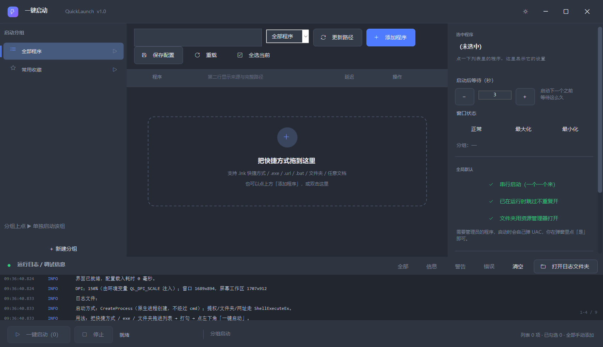

# 一键启动 QuickLaunch

> 勾选一堆程序，点一下，**按各自设定的间隔依次打开**。Windows 桌面小工具，单文件约 160 KB，零依赖，绿色免安装。


---

## 它解决什么问题

每天早上要开浏览器、微信、编辑器、TODO、笔记、终端……一个个点开，还得等前一个起来再点下一个，不然机械硬盘/老机器会卡。

这个工具就是干这个的：**把要开的程序攒成一个列表，勾上，点一次「一键启动」**，它按每个程序自己的间隔秒数一个接一个拉起来，中间不抢 CPU 和磁盘。

启动速度是重点：窗口 **约 60 毫秒**可见，界面（70+ 自绘控件）**约 110 毫秒**构建完成 —— 之前用 Python + tkinter 写的版本要等好几秒。

---

## 功能

| 功能 | 说明 |
|---|---|
| **勾选启动** | 每行一个勾选框，只启动勾上的 |
| **每个程序独立间隔** | 1~5 秒（可任意填），上一个启动完等这么久再启动下一个 |
| **手动拖入** | 从桌面/开始菜单把 `.lnk`、`.exe`、文件夹、`.url`、`.bat`、文档直接拖进窗口 |
| **分组** | 日常 / 工作 / 系统工具，底栏可单独启动某一组 |
| **不经过 cmd** | 用 Win32 `CreateProcess` 原生启动，快、无黑框、能拿到真实 PID 和错误码 |
| **自动提权** | 需要管理员的程序自动走 `ShellExecuteEx runas` 弹 UAC，而不是报个「启动失败」 |
| **跳过重复** | 已经在运行时跳过，不重复开第二个 |
| **深色界面 + 高 DPI** | PerMonitorV2 感知，150% 缩放下文字原生清晰，自绘滚动条/开关/列表 |
| **日志** | 界面里实时看，同时写 `logs\launch-yyyy-MM-dd.log`，后台线程写盘不卡界面 |
| **完全离线** | 不联网、不上报、不写注册表，配置就是一个 JSON 文件 |

---

## 快速开始

### 方式 A：下载现成的 exe（推荐）

去 [Releases](../../releases) 下载最新版本，解压到任意目录，双击 `QuickLaunch.exe`。

> 只用到系统自带的 .NET Framework 4.8（Win10 1803+ / Win11 都有），**不需要装任何运行库**。

### 方式 B：自己编译

```bat
git clone <本仓库地址>
cd QuickLaunch
编译.cmd
```

编译产物在 `dist\QuickLaunch.exe`。

**需要的东西：只有一个 C# 编译器。** 优先用 Roslyn（VS / Build Tools 自带），找不到就用系统自带的
`%WINDIR%\Microsoft.NET\Framework64\v4.0.30319\csc.exe`。**不需要 Visual Studio，不需要 .NET SDK，不需要 NuGet。**

---

## 怎么用

### 1. 把快捷方式拖进来

| 拖什么 | 结果 |
|---|---|
| `.lnk` 快捷方式 | 解出真实路径 + 参数 + 起始位置，并**记住原快捷方式** |
| `.exe` | 直接收录 |
| 文件夹 | 收录，启动时用资源管理器打开 |
| `.url` | 用默认浏览器打开 |
| `.bat` / `.cmd` | 用 cmd 执行 |
| 任意文档（pdf/docx/txt…） | 交给系统关联程序 |

也可以点工具栏「添加程序」，或**双击列表空白处的虚线区域**。

### 2. 勾选 + 设间隔

点行左侧的方框打勾；选中某行后，在右侧「启动后等待（秒）」里用 `−` / `+` 或直接输入。
要批量勾选，用搜索框筛出来再点「全选当前」。

### 3. 点左下角「一键启动」



---

## 它是怎么启动程序的

**不用 cmd。** 和你在资源管理器里双击图标是同一套机制：

| 启动的东西 | 实际调用 | 经过 cmd |
|---|---|---|
| `.exe` | **`CreateProcess`**（Win32 原生创建进程） | ❌ |
| 需要管理员的程序 | `ShellExecuteEx` + `runas` → 弹 UAC | ❌ |
| 文件夹 | `ShellExecuteEx` + 系统关联（等价于地址栏输入路径） | ❌ |
| 网址 / Store 应用 | `ShellExecuteEx` + `open` | ❌ |
| 文档 | `ShellExecuteEx` + `open` | ❌ |
| **`.bat` / `.cmd`** | `cmd.exe /c "xxx.bat"` | ✅ 仅此一种 |

为什么不 `cmd /c start`：每次多拉一个 cmd 进程，慢、闪黑框，而且拿不到真实退出码。
用 `CreateProcess` 能精确拿到 Win32 错误码 **740 = 需要管理员权限**，据此自动改用提权启动。

从 `.lnk` 拖进来的条目，启动时**直接 ShellExecute 那个 .lnk** —— 保留快捷方式里的参数、起始位置、
AppUserModelID 和「以管理员身份运行」标记，最接近真正双击。

---

## 配置与日志

| 内容 | 位置 |
|---|---|
| 配置 | `%APPDATA%\QuickLaunch\config.json`（不可写时退回 exe 同级 `config\`） |
| 日志 | exe 同级 `logs\launch-yyyy-MM-dd.log`（按天切分，自动清理 30 天前） |

- 配置是纯 JSON，换机器直接拷过去
- 每次保存都会留一份 `config.backup.json`
- 日志面板的「打开日志文件夹」可直接定位

---

## 命令行 / 排障

`QuickLaunch.exe` 是 GUI 子系统（双击不弹黑窗），但同目录还会编译出一个
**控制台版 `QuickLaunchDiag.exe`**（同一份源码，`/target:exe`），诊断用它，输出会直接打在 cmd 里：

```bat
QuickLaunchDiag.exe --selftest             :: 构建整个界面但不显示，验证界面代码
QuickLaunchDiag.exe --uicheck              :: 体检：DPI、控件尺寸、重叠、滚动条、字形、列表绘制
QuickLaunchDiag.exe --launch-test          :: 真实启动 3 个无害目标，验证串行 + 延迟精度
QuickLaunchDiag.exe --launch-one="路径"     :: 只启动一个程序，打印解析/命令行/PID/退出码/存活
QuickLaunchDiag.exe --savetest             :: 验证「生成条目→并入配置→保存→回读」整条链路
```

`--launch-one` 是排查「点了打不开」的主力工具：

```bat
QuickLaunchDiag.exe --launch-one="E:\某软件\app.exe"
QuickLaunchDiag.exe --launch-one="C:\Users\你\Desktop\某快捷方式.lnk"
```

输出同时写进 `logs\launch-one-report.txt`（UTF-8，记事本可读）。

> 所有诊断模式都会把配置目录隔离到系统临时目录（环境变量 `QL_CFGDIR`），
> **绝不会碰到你真实的 config.json**。

---

## 目录结构

```
QuickLaunch/
├── src/                        源码
│   ├── app.manifest            DPI 感知 + asInvoker（拖放必需，不能提权）
│   ├── Program.cs              入口 + 6 种诊断模式
│   ├── MainForm.cs             界面骨架、工具栏、底栏、屏幕适配
│   ├── MainForm.Right.cs       右侧设置面板（含自绘滚动条）
│   ├── MainForm.Logic.cs       事件、拖放、启动线程、配置存取
│   ├── CustomControls.cs       自绘控件 + DPI 缩放中心（Theme）
│   ├── Launcher.cs             启动引擎：CreateProcess / ShellExecuteEx / 串行调度
│   ├── ShortcutResolver.cs     .lnk 二进制解析（快）+ WScript.Shell COM 兜底
│   ├── ConfigStore.cs          配置读写（原子写入 + 备份）
│   ├── Logging.cs              内存队列 + 后台线程写文件
│   ├── MiniJson.cs             零依赖 JSON 读写
│   ├── Models.cs               数据模型 + 图标缓存
│   └── Helper.cs               路径 / 字符串工具
├── tools/
│   ├── LayoutTest.cs           布局回归测试（5 尺寸 × 3 缩放 × 12 断言 = 180 项）
│   ├── Shot.cs                 把窗口渲染成 PNG
│   └── make-icons.py           图标生成（7 套方案 + 多尺寸 ico）
├── icons/                      生成的图标
├── docs/screenshots/           README 用图
├── build.ps1                   编译
├── test-all.cmd                编译 + 全部测试
├── 编译.cmd                    双击编译
└── 使用说明.md                 详细文档（含布局铁律、踩过的坑）
```

---

## 编译与测试

```bat
test-all.cmd                                :: 编译 + 布局回归(180 项) + 界面自检
bin\LayoutTest.exe dist\QuickLaunch.exe     :: 只跑布局回归
bin\Shot.exe dist\QuickLaunch.exe shots 1.5 :: 渲染截图自己看
```

`LayoutTest` 的每条断言都对应一次真实事故（文字重叠、行高不够、按钮被截断、右上角按钮整组消失……），
详见 [使用说明.md](使用说明.md) 的「界面布局的铁律」。

### 换图标

```bat
python tools\make-icons.py     :: 重新生成 7 套方案 + 对比图
编译.cmd -Icon 4               :: 把 4 号图标嵌进 exe
```

---

## 已知限制

1. **不扫描系统**：列表里的东西全部由你手动拖入（刻意设计，避免塞进用不上的条目）
2. 需要管理员的程序会弹 UAC 让你确认
3. 跨不同缩放比例的显示器拖动窗口时不会自动重新缩放（.NET Framework 4.8 WinForms 的固有短板）
4. 个别程序（实测 Obsidian）会拒绝被「程序」启动 —— 进程秒退、退出码 0，但鼠标双击快捷方式正常。
   这是它自身的启动守卫，把这类程序留在列表里手动打开即可。详见 [使用说明.md](使用说明.md)

---

## 许可证

[MIT](LICENSE) —— 随便用、随便改，保留版权声明即可。
